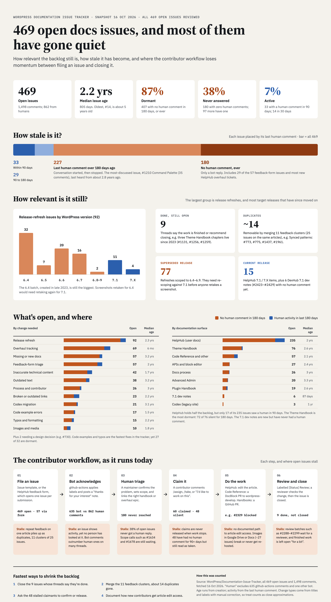

## The Why

Documentation drift occurs often as WordPress versions change. Onboarding is tough for new contributors, and issue logs grow as minor fixes turn into process bottlenecks.

This project hopes to relieve strain on the WordPress Documentation Team, by allowing new contributors, WordPress Credits students, and the Docs Team to collaborate more effectively and maintain up-to-date documentation.

## Project Standards

**Repository**

- Markdown files that are in lowercase are working drafts.
- Other working drafts are hidden, for now. 
- The underlying specification will be hidden, but available for demo.

**Roles**

- Human: Ideation, specification, decision-making, and oversight throughout the project.
- Spec Kit: The brain of the project, responsible for planning, task management, and documentation.
- Claude: AI backbone for planning, ideating, and implementation of tasks.

### Spec Kit by GitHub

Agentic, Spec-Driven Development

> Build with a spec, fix a bug, or assess an idea — with your coding agent.

[https://github.com/spec-kit/](https://github.github.com/spec-kit/)

### Spec Kit + Claude for SDD

Spec Kit can be considered the brain of the project

GitHub's Spec Kit will be the AI harness for creating the specification for the project, acting as the central coordinator. 

Claude will serve as the AI backbone for planning, ideating, and implementation of the tasks along the way. 

**Spec Kit will be used for:** 

- Technical Documentation on Project Specification
- Project Planning and Task Management (Milestones, Deliverables)
- Knowledge Management and Documentation
- Repository Management and Version Control
- Bug Tracking
- Other Project Management Tasks

**Claude will be used for:** 
    
- **Planning:** Handed off from `specify-plan`, Claude's Plan Mode will create the actual implementation plan 
- **Implement:** Handed off from `specify-implement` 
- **Security Review:** Enforce security guardrails

**The Human** 

[@flexseth:](https://github.com/flexseth) Ideation, decision-making, and project oversight.