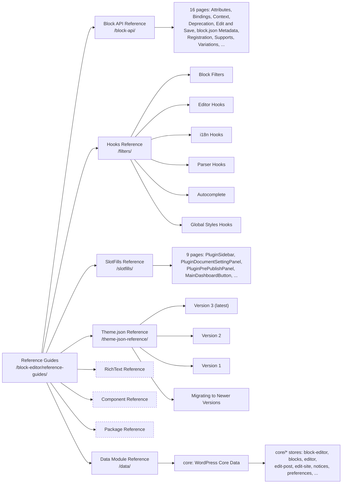

# Block Editor Reference Guides: page hierarchy

Source: https://developer.wordpress.org/block-editor/reference-guides/ (root last modified 2026-10-14, fetched 2026-11-08 via the docs lookup agent pattern, `?output_format=md`).

Dashed nodes are sections whose children were not enumerated. The root page lists no children for them, and their landing-page URLs were not linked from the root.

## Notes

- Block API: the root page lists fewer items than the section page. The root omits Bindings, Selectors and Styles. The diagram uses the section page's 16.
- Hooks, SlotFills, Theme.json and Data children come from the root page only. Their section landing pages were not fetched.
- Not covered: Components and Packages, the two largest sections. Child counts are unknown. A second lookup of those section pages would fill them in.
